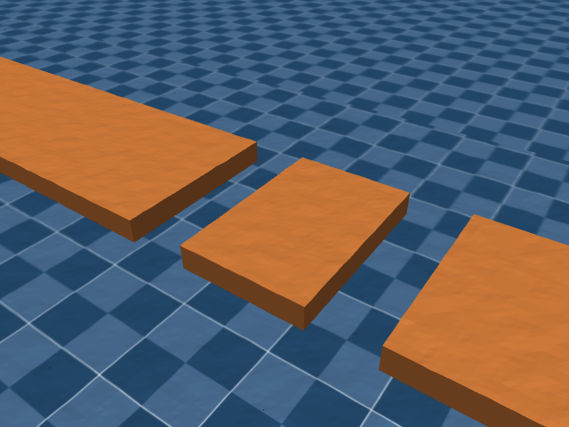

# G1 23DoF MuJoCo sim2sim

本目录使用你提供的 23DoF URDF、actor、depth encoder 和 policy_metadata.json，配置独立于根目录的 29DoF 策略。关节为双腿 12 + 腰 yaw 1 + 双臂各 5（含 wrist roll）。共享原项目的 STL 和渲染、手柄、深度预处理工具。

## 启动

在项目根目录执行，使用项目 Python 3.11：

```bash
# 检查模型、URDF 哈希和两份 ONNX 的实际推理接口，无需桌面
.venv/bin/python -E g1_23dof/check_config.py

# 实际相机渲染及一次完整策略控制，需要桌面或可用的 OpenGL 后端
.venv/bin/python -E g1_23dof/check_config.py --render

# 默认平地，先验证新策略
.venv/bin/python -E g1_23dof/sim2sim.py --profile

# Xbox 手柄 + 木板场景
.venv/bin/python -E g1_23dof/sim2sim.py --scene rough --control gamepad --profile

# 限时运行 10 秒仿真时间，结束后关闭窗口
.venv/bin/python -E g1_23dof/sim2sim.py --seconds 10 --profile

# 只检查默认关节姿态的 PD 预览，没有策略平衡能力
.venv/bin/python -E g1_23dof/sim2sim.py --preview
```

VS Code 左侧「运行和调试」选择「23DoF：平地策略验证」或「23DoF：木板手柄验证」，再点绿色三角形。不要使用系统 `/usr/bin/python3`。

键盘上下箭头增减前进速度，左右箭头增减转向速度，空格指令归零，R 重置。手柄左摇杆上推前进、右摇杆左右转向、B 停止、Y 重置；连接和重置后先回中。默认前进范围 0～0.9 m/s、转向 ±1 rad/s；这些交互范围是参考设置。零速度指令由策略自行平衡，不保证机器人完全不移动。

## 配置与重新生成

- `config.py` 的 `POLICY_DIR` 现指向本目录 `policy/exported/`，从该目录读取 actor、depth encoder 和 metadata 三件套（当前 metadata 为 `model_40000.pt`）。启动时打印实际路径、权重哈希前缀及 checkpoint。根目录 `policy/` 下的旧导出仍保留。
- 关节顺序、动作偏移/缩放、观测归一化和 PD 增益均从选中的 `policy_metadata.json` 读取。观测与动作均使用训练导出的 PhysX 顺序；SDK 编号不等于数组下标。
- 策略输入：6 组本体观测各 8 帧，合计 624 维；拼接深度特征 128 维，actor 总输入 752 维、输出 23 维。深度编码器输入 `(1,8,18,32)`。控制周期 20 ms，物理步长 5 ms。
- 根体使用元数据指定的 `pelvis`；不沿用 29DoF 的躯干 IMU 或腰关节符号修正。
- `rough_terrain_cfg.py` 控制本目录木板场景，每块横向长 90 cm、沿行走方向宽 60 cm，净缝隙固定 30 cm（2026-10-20 更新）。修改 `min_gap`、`max_gap` 后保存，运行下方地形命令，再重启仿真。
- URDF 或模型补充参数修改后运行模型生成命令。哈希校验不匹配时会拒绝生成，应先确认模型确实对应这套策略。

```bash
.venv/bin/python -E g1_23dof/rough_terrain_generator.py
.venv/bin/python -E g1_23dof/build_model.py
```

## 朝向与路径保持

23DoF 默认 `COMMAND_FEEDBACK_MODE="path"`。行走时用世界坐标的横向误差生成目标朝向，再用 pelvis 朝向误差生成策略的 yaw-rate 指令；仍由原策略输出关节动作。`--feedback heading` 只保持朝向，`--feedback off` 使用原始手动指令，便于对照。手动转向优先，松开转向后从当前位置与实际朝向建立新参考线；空格/B 停止并清空旧参考，R/Y 重置全部相关状态。日志分别记录手动 yaw 和实际送入策略的 yaw，后者在手动转向为零时也可能非零。

初始参考线通过重置后的 pelvis 位置，方向为其实际朝向；这一控制器不自动读取木板方向或识别路线终点。仅朝向保持不能消除侧向速度造成的位置漂移。当前增益 2、自动 yaw-rate 上限 1 rad/s、前视距离 1 m，路径纠偏朝向相对参考线最多偏转 30°。参数在 `config.py` 的 `HEADING_HOLD_*`、`PATH_*` 中调整。

20 秒同模型、同种子对照与复测命令详见 [朝向保持验证记录](docs/heading_feedback.md)，原始轨迹见 [feedback_comparison.json](docs/feedback_comparison.json)。`--profile` 输出世界 Y、相对参考线的横向误差、pelvis yaw、目标 yaw、身体横向速度、手动与策略 yaw 指令。

首帧深度历史填充修复后，当前 40000 轮策略启动零速可以站立，但行走后速度归零仍会持续踏步。旧速度历史在约 0.16 秒后已清除；关闭反馈、清空历史或本次 2 秒减速对照都未解决停止转换。当前结论见 [行走后停步诊断](docs/walk_stop_diagnosis.md)；修复前的启动抬脚历史记录见 [默认状态抬脚诊断](docs/idle_diagnosis.md)。本次诊断保留已验证的控制逻辑。

## Perlin 粗糙平台和沟底

2026-10-20 已在 `scene_rough.xml` 启用几何粗糙表面：16 块木板、起终点平台及沟底共用同一片 Perlin 噪声，机器人碰撞和深度相机均能感知起伏。板面名义高度为 0 m，沟底名义高度沿用当前设置 −0.12 m；木板横向 90 cm、行走方向 60 cm、净缝隙 30 cm。



在 `rough_terrain_cfg.py` 的 `PERLIN_SETTINGS` 调整：

| 参数 | 当前值 | 含义 |
| --- | --- | --- |
| `noise_scale` | `[0.01, 0.04]` | 随 `difficulty` 线性插值的噪声缩放参数 |
| `difficulty` | `0.5` | 当前缩放为 0.025；改为 1.0 则为 0.04 |
| `height_limit` | `0.005` m | 实际起伏限制在 ±5 mm；整片噪声按统一比例缩小，`None` 恢复训练原始幅值 |
| `noise_frequency` | `20` | 原样传入训练库的 Perlin 采样算法 |
| `fractal_octaves` | `2` | 两层噪声 |
| `fractal_lacunarity` / `fractal_gain` | `2.0` / `0.25` | 下一层频率加倍、权重为前层的四分之一 |
| `centering` | `True` | 按训练算法对内部完整噪声场去均值，再裁剪 |
| `horizontal_scale` | `0.025` m | 高度场采样间距 2.5 cm |
| `vertical_scale` | `0.001` m | 按训练算法截断量化到 1 mm |
| `seed` | `23` | 固定后生成结果可复现，仿真重置不会换表面 |
| `ground_padding` | `1.0` m | 粗糙沟底覆盖范围在路线四周额外扩展 1 m |

`noise_scale` 不代表所有位置都凸起 1～4 cm。当前启用了 ±0.5 cm 的实际起伏上限；保留 1 mm 量化后，该种子下平台与沟底的噪声实际约为 −4～+5 mm。板面高度约为 −0.004～+0.005 m，沟底约为 −0.124～−0.115 m；各块板不一定都出现最大峰和最大谷。设置 `PLANK_SETTINGS["perlin_cfg"] = None` 可恢复平整表面。

设置起伏只需修改 `PERLIN_SETTINGS["height_limit"]`，单位为米。例如 ±0.5 cm 设置 `0.5/100 = 0.005`，±1 cm 设置 `0.01`。保存后重新运行地形生成器，再重启仿真。上限小于 `vertical_scale=0.001` m 时，量化会使表面变平；想生成更细的起伏需同时降低高度量化步长。

计算过程：先得到训练参数对应的原始噪声 `n(x,y)`。原始噪声缩放为 `0.01 + 0.5*(0.04-0.01) = 0.025`，但实际峰值仍由噪声场决定。设所需上限为 `A`，生成器计算整片场的 `M=max(abs(n))`，当 `M>A` 时统一乘 `k=A/M`；否则保持原值。最后向零截断到 1 mm 的网格：`h=trunc(k*n/0.001)*0.001`（保持时 `k=1`），因此 `abs(h)<=A`。所有板面与沟底共用同一系数，保持空间噪声形状，不把高处裁成平顶。`height_limit=None` 则跳过这一缩小步骤。

生成器先确定平台与缝隙布局，然后生成整片噪声并按各几何体的位置取样。使用分开的 MuJoCo 高度场保留竖直板边和精确净缝隙，避免用一个阶梯高度场将板边变成斜坡。高度场位置与纵向缩放会同时记录最低高度和峰谷差，使向下凹陷也参与碰撞。路线内的沟底由粗糙高度场承托，外围的背景平面放到最低谷以下，避免填平负向起伏。沿用原有摩擦配置。

噪声算法来自 [InstinctLab Perlin utility](https://github.com/project-instinct/InstinctLab/blob/main/source/instinctlab/instinctlab/utils/perlin.py)，难度插值与高度量化对应 [训练地形生成代码](https://github.com/project-instinct/InstinctLab/blob/main/source/instinctlab/instinctlab/terrains/height_field/hf_terrains.py)。采样值已与上游原始函数比较一致；来源及许可见 `../third_party/instinctlab/README.md`。你提供的训练工程路径在本机不存在，因此没有宣称与那条训练路线逐点一致；训练的完整场地尺寸、种子和难度仍会影响具体表面。

首次粗糙表面验证（未限制幅值时）：33 项测试通过，包括平台/沟底共用噪声、毫米量化、种子复现、真实射线高度及小球接触；零速度指令运行 6 秒无数值发散，最大身体倾斜约 3.9°，深度观测为 `(1,8,18,32)`。随后新增 ±5 mm 上限，验证多个种子和难度下的上限、量化以及编译后的碰撞高度。这些检查未验证连续跨越全部木板。

## 仍需与训练配置核对的参数

导出元数据没有提供完整深度预处理及物理配置。目前沿用项目参考值：原图 270×480，最近邻缩放到 36×64，顶部裁 18 行、左右各裁 16 列；近处无效像素修复和高斯滤波，深度截到 0～2.5 m 并归一化到 0～1。缓存 60 帧，每隔 5 帧抽取一帧共 8 帧，额外随机延迟 0～1 帧。相机位姿取 URDF `d435_link`，垂直视场角 58.29°。

历史顺序沿用原项目的各观测分组、组内从旧到新排列。重置后本体历史填充初始静态观测，深度历史从零逐步填入。armature=0.01 kg·m² 用于补足 URDF 未提供的电机转子惯量，初始 pelvis 高度 0.793 m。训练侧电机速度模型、接触参数、自碰撞过滤也未完整导出。

接口检查通过仅说明模型和推理链路可用；要确认与训练环境一致及稳定跨越木板，需要继续核对上述参数并实测。模型来源详见 `MODEL_SOURCE.md`。

## 本机验证记录（2026-10-19）

- URDF 哈希匹配；平地、木板模型的 23 个关节和电机、质量、关节轴、硬限位及力矩上限校验通过；两份 ONNX 实际推理输出均为有限值。
- RTX 3070 Ti 上带窗口的平地零指令运行 10 秒：控制约 49.5 Hz，pelvis 高度最低 0.749 m，身体最大倾斜约 3.2°，末位置约 `(0.003,-0.010,0.761)` m。
- 当时的木板场景（更新尺寸前）先静止 2 秒再给 0.4 m/s 前进指令，总计 20 秒：未出现数值发散，约第 10 秒到达 `(3.748,-0.149,0.754)` m；后续出现明显侧偏并走离木板，末位置约 `(8.326,5.729,0.398)` m。因此尚未验证连续稳定跨越全部木板，需人工转向并继续核对训练配置。
- 重置能够恢复自由基座位置/姿态、23 个默认关节角、零动作和历史缓存。无策略的 PD 姿态预览会倾倒，不能作为策略平衡测试。
